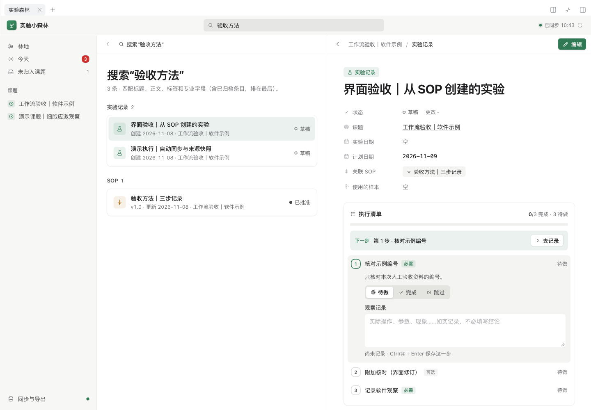

# Experiment Forest · 实验森林

**在 Harness 管实验，在 Obsidian 读资料。**

一个为个人研究工作设计的 DeepSeek Harness 插件。把课题、方法、执行过程和观察连在一起，从 SOP 开始一次实验，回来时知道做到哪一步，也能在 Obsidian 中自然地阅读和整理。

[下载 v0.2.0](https://github.com/ZJUZhiyuCai/experiment-forest/releases/tag/v0.2.0) · [安装指南](部署指南.md) · [上手使用](👋给朋友的使用说明.md) · [Obsidian 联动](docs/OBSIDIAN.md) · [全部文档](docs/INDEX.md)


*真实 Harness 运行截图，内容为软件验收示例。界面采用克制的中性色、宽松留白和清晰层级，支持浅色、深色及窄屏。*

## 从计划到实验记录

| 你要做的事 | 实验森林如何帮助你 |
| --- | --- |
| 整理一个课题 | 关联实验、研究笔记、SOP、样本和计划，沿着资料关系继续阅读。 |
| 按方法开始实验 | 从 SOP 创建执行草稿，固定当时的方法正文、修订和步骤；后续修改 SOP 不改变已有实验的依据。 |
| 记录真实过程 | 逐步填写观察，标记完成或跳过并记录原因；保留进度，随时继续。 |
| 安排今天的工作 | 查看逾期、今日、未来七天、未排期事项及 AI 待核对资料。 |
| 请 DeepSeek 帮忙 | 在 Harness 对话中查找资料、读取关联上下文、整理草稿；草稿带来源并等待人工核对。 |
| 回到知识库整理 | 保存后自动同步到本机 Obsidian，使用 Markdown、双向链接和 Bases 阅读。 |

实验结果、实际日期和完成状态由你记录。清单完成不会自动生成成功结论；AI 生成内容保留待核对标记，观察和结论仍需人工确认。



## 安装

当前版本为 **0.2.0**，已核验 **DeepSeek Harness 0.2.2-rc.1**。CLI 运行及源码构建要求 **Node.js ≥ 24.9**；Desktop 使用其内置运行时。Harness 的插件 API 仍在变化，暂不声明其他版本兼容。

### 使用安装包

从 [Release](https://github.com/ZJUZhiyuCai/experiment-forest/releases/tag/v0.2.0) 下载 `dsh-experiment-forest-0.2.0.tgz`。对于已经配置好的 Harness **web** profile，退出该 Host 后安装，再重新启动：

```sh
dsh plugin --profile web add /absolute/path/dsh-experiment-forest-0.2.0.tgz
dsh web
```

把路径替换成下载文件的实际绝对路径。在会话右侧栏选择 **实验森林**，也可以展开为完整工作台。模型和密钥沿用 Harness 配置。

**首次使用 Harness**：先安装并运行官方 `0.2.2-rc.1`，完成 web profile 初始化，再按上面的步骤添加插件。完整命令见 [安装指南](部署指南.md)。

**Desktop 用户**：需要使用该 Desktop 安装自带的内置命令，管理已经初始化的 `desktop` profile。npm 安装的 `dsh` 会拒绝 `--profile desktop` 插件管理请求；详见 [安装指南](部署指南.md)。

### 从源码安装

```sh
git clone https://github.com/ZJUZhiyuCai/experiment-forest.git
cd experiment-forest
npm ci --ignore-scripts
npm run build
dsh plugin --profile web add "$PWD"
dsh web
```

同样需要先准备好 Harness web profile。安装包已包含构建产物，不需要在使用者电脑上重新构建。

## Obsidian：连接一次，保存即同步

1. 在运行 Harness Host 的同一台电脑、同一个操作系统用户下，用 Obsidian 打开目标资料库。
2. 在实验森林的 Obsidian 面板选择该资料库并连接。
3. 继续在 Harness 工作。每次保存都会在后台更新 Obsidian 的 `Experiment Forest-…` 专用目录，Host 重启后也会继续同步。

**无需导出、解压或逐次手工同步。** Obsidian 窗口关闭时也能更新文件；重新打开即可阅读。

每条资料都是带属性的 Markdown 页面，包含正文、来源、执行记录和关联链接。文件路径使用稳定 ID，修改标题不会改变链接目标。`Index.md` 提供目录，`Forest.base` 提供可筛选的资料视图；你可以在 Obsidian 调整视图，或在自己的文献笔记中引用实验页面。

实验主数据在 Harness 编辑。直接修改、移动或删除生成的实验页面，会保留现状并提示冲突；其他页面继续同步。Obsidian 的编辑不会反向导回 Harness，断开连接也不会删除文件。`Forest.base` 首次创建后由你管理，后续同步保留其排序、筛选和列设置。

远程服务器上的 Host 只能访问服务器本机资料库，不能直接写浏览器所在电脑。完整范围、故障处理和恢复副本说明见 [Obsidian 使用说明](docs/OBSIDIAN.md)。

## 与 DeepSeek 一起工作

插件向 Harness 提供四个工具，沿用会话中的工具权限：

| 工具 | 用途 |
| --- | --- |
| `forest_search` | 搜索研究资料。 |
| `forest_read` | 读取一条资料的完整记录。 |
| `forest_context` | 获取目标及其关联资料的有界上下文。 |
| `forest_create_draft` | 保存带 AI 来源、等待人工核对的新草稿。 |

例如：“找出这个课题关联的方法和最近的实验记录，列出下次实验前要核对的问题。”也可以让模型依据已有资料整理草稿，再到工作台核对。实际模型调用由你的 Harness 供应商配置和权限决定。

## 数据、备份与迁移

- 资料保存在 Harness Host 的 Storage 中，属于当前 profile。同一 profile 的会话共享数据，不同 profile 分开保存。
- 编辑使用修订号检测冲突；冲突时保留当前输入，核对后再保存。归档保留原文与历史关联。
- JSON 备份用于完整恢复与迁移。导入前会显示数量、缺失关联和冲突；重复导入不会重复创建或覆盖后来编辑的资料。
- Obsidian 是阅读镜像；隐藏 `.recovery` 目录保存同步前的副本，不自动清理，也不能代替独立备份。

从原来的浏览器版升级，请先读 [迁移指南](docs/MIGRATION.md)。旧版“导出所有数据”遗漏了课题、样本和计划，新版不会主动覆盖或清除旧站的浏览器数据。

## 当前边界

面向个人研究工作区；课题关联不是权限隔离。RPC 限拥有者连接，同一 profile 使用一个 Host 进程，进程内冲突检查不提供跨进程事务。当前未实现多人协作审批、通用修订历史、电子签名、附件管理、仪器接入或样本库存扣减。

自动化测试、真实浏览器与 Obsidian 验收均使用示例数据。模型工具已通过官方执行链验证，验收没有消耗真实模型请求；账号下的模型调用仍取决于使用者的 Harness 环境。详见 [验证记录与已知限制](docs/VERIFICATION.md)。

## 开发

```sh
npm ci --ignore-scripts
npm run dev        # 独立 .dsh-dev profile，禁用模型供应商

npm run typecheck
npm test
npm run build
npm run test:host  # 官方 Host 集成验证，不请求模型
npm pack
```

开发地址以启动输出为准。v0.2.0 已通过 **118 项测试**、类型检查、构建、官方 Host 验证及独立安装包安装验证，并在真实 Chrome / Obsidian 中检查过保存、同步和窄屏布局。

```text
client/       工作台界面与 Harness Client 接入
plugin/       Host 服务、模型工具、领域事务与同步
shared/       数据模型与前后端契约
scripts/      构建、开发与集成验证
tests/        工具、资料输出与接入检查
src/          旧浏览器版，保留供数据迁移参考
```

旧静态站不是当前插件的演示入口，旧 API Key 设置和启动脚本也不适用于新版。历史资料、审查记录及产品参照统一收录在 [文档索引](docs/INDEX.md)。

## 反馈与许可

欢迎通过 [Issues](https://github.com/ZJUZhiyuCai/experiment-forest/issues) 反馈。请附上插件与 Harness 版本、操作步骤和错误信息，并移除研究隐私与凭据。

[MIT License](LICENSE) · 蔡志宇（Zhiyu Cai）
