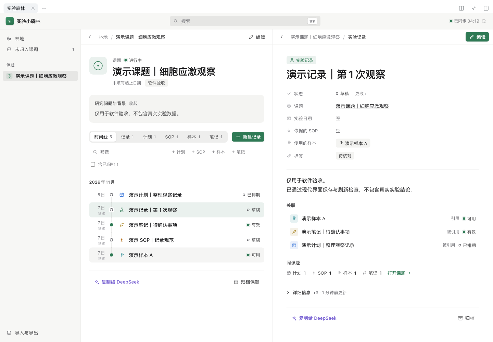

# 实验小森林 · DeepSeek Harness 插件

把课题、实验记录、研究笔记、SOP、样本和计划放在 DeepSeek Harness 的同一工作台里。AI 帮助检索资料和整理草稿，研究记录由你掌握。

这次重构将原来的浏览器单机应用改为 **Harness 原生 Host + Client 插件**：右侧栏工作台、Host 持久化服务和三个模型工具使用同一份数据。模型与密钥沿用 Harness 的配置，无需在网页重复填写，不再提供模拟 AI 回复。

界面由远端 Claude 按现代 Apple / Notion 风格重做：中性底色、宽松留白、清晰的资料层级，以及浅色与深色模式。



上图为真实 Harness 中的插件页面，内容均为软件验收示例。

## 使用

要求 Node.js **24.9 或以上**、DeepSeek Harness **0.2.2-rc.1**。当前只对这个已核验的 Harness 版本声明兼容；它的插件 API 仍在变化。

```sh
# 进入包含 client/、plugin/ 的新版源码目录
cd /absolute/path/experiment-forest
npm ci --ignore-scripts
npm run build

# 用项目的实际绝对路径替换下面的路径；安装到你使用的 profile
dsh plugin --profile desktop add /absolute/path/experiment-forest
```

重新打开该 profile 的 Harness，在会话右侧栏的引导页中选择 **实验森林**。Web 用户改为 `--profile web` 安装，然后运行 `dsh web --no-open`。插件无单独的 HTTP 数据接口、账户体系或模型密钥。

使用预构建安装包时，可直接执行 `dsh plugin --profile desktop add /absolute/path/dsh-experiment-forest-0.1.0.tgz`，无需先构建源码。

开发预览使用 `npm run dev`，在隔离的 `.dsh-dev` 开发 profile 启动本机 Harness。此实例禁用模型供应商，适合不消耗模型额度的操作验收；实际地址以启动输出为准。正式使用的数据属于你安装插件的 Harness profile，不存在浏览器 localStorage。

## 工作流

- 新建课题，再关联实验、笔记、SOP、样本或计划；搜索、编辑和归档都作用于真实保存的数据。
- 并发修改通过记录版本号检测；冲突时保留编辑内容，刷新核对后重试。归档不会删除原文或断开历史关联。
- 在 Harness 聊天中让 DeepSeek 使用 `forest_search` 查找资料、`forest_read` 读取原文，或使用 `forest_create_draft` 保存草稿。AI 创建的记录带来源和未复核标记，不自动批准 SOP 或覆盖正式实验数据。
- 导出 JSON 备份；导入前检查数量、缺失关联和冲突，再确认合并。同一份备份重复导入不会重复创建，也不会覆盖后来编辑的记录。

课题关联不等于权限隔离。当前版本面向同一 Harness profile 的个人科研工作区；同 profile 的会话共享记录，插件 RPC 只允许拥有者连接，不同 profile 分开保存。模型工具沿用 Harness 的会话工具权限。使用默认 JSON 存储时，同一 profile 仅运行一个 Host 进程；多进程同时写入不受本插件的进程内版本检查保护。多人租户、附件文件管理、思维导图、旧版日程编辑暂未实现。

## 迁移旧数据

旧版“导出所有数据”实际只导出了实验、笔记和 SOP，未包含课题、样本和计划。请先完整备份再迁移，见 [迁移说明](docs/MIGRATION.md)。新版不会主动访问、覆盖或清除旧站的浏览器数据。

旧 `src/` 代码作为迁移参考保留，可用 `npm run dev:legacy` / `npm run build:legacy` 启动。旧版说明存于 [LEGACY_README](docs/LEGACY_README.md)，其中静态部署与 API Key 设置不适用于新插件。

## 开发与验证

```sh
npm run typecheck
npm test
npm run build
npm run test:host
npm pack
```

`test:host` 使用官方 Cordis、Storage、Tool Registry 和 RPC Gateway，验证加载、参数校验、版本冲突、磁盘持久化、重启和卸载，不请求模型。浏览器验收与已知限制见 [验证记录](docs/VERIFICATION.md)。

```text
client/       Claude 重做的工作台与原生 Client 适配
plugin/       Host 服务、工具、领域事务与迁移
shared/       JSON 数据模型与前后端契约
scripts/      构建、开发运行和原生 Host 集成验证
tests/        工具、导出和接入行为检查
src/          旧版前端，仅作为迁移参考
```

[后端审查](docs/BACKEND_REVIEW.md) · [Claude 前端审查](docs/FRONTEND_REVIEW.md) · [Claude 最终视觉说明](docs/FRONTEND_VISUAL_NOTES.md) · [Claude 初步设计（历史稿，含未实施设想）](docs/FRONTEND_DESIGN.md)

[原稿与本机适配说明](docs/LOCAL_ADAPTATIONS.md)

MIT · 蔡志宇（Zhiyu Cai）
